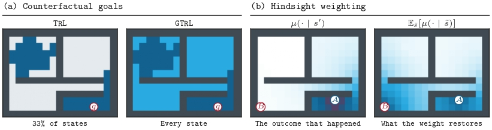
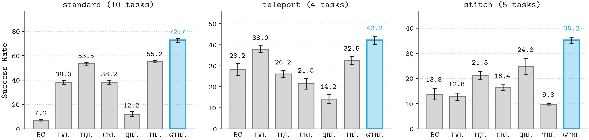

<div align="center">

<div id="user-content-toc" style="margin-bottom: 50px">
  <ul align="center" style="list-style: none;">
    <summary>
      <h1>GTRL</h1>
      <h2>GTRL: Grounding Divide and Conquer Value Learning with Temporal Differences</h2>
    </summary>
  </ul>
</div>

</div>

[](https://arxiv.org/abs/2609.33259)

> If you find our work useful in your research. Please consider giving a star ⭐ and citation 📚:

 ```bibtex
@misc{chowdhury2026gtrlgroundingdivideandconquervalue,
      title={GTRL: Grounding Divide-and-Conquer Value Learning with Temporal Differences}, 
      author={Abdul Monaf Chowdhury and MD Sameer Iqbal Chowdhury and Shifat E Arman and Md Mehedi Hasan},
      year={2026},
      eprint={2609.33259},
      archivePrefix={arXiv},
      primaryClass={cs.LG},
      url={https://arxiv.org/abs/2609.33259}, 
}
``` 
## Abstract
In offline goal-conditioned reinforcement learning (GCRL), divide-and-conquer scales to long horizons by joining two shorter segments at a subgoal. However, under stochastic dynamics, the base case of this rule values the luckiest trajectories through the data. The subgoal must also lie on a shared trajectory, so a state-goal pair that no trajectory connects gets no value update at all. To address both, we present **Grounded Transitive RL (GTRL)**, an offline GCRL value learning algorithm that grounds the divide-and-conquer update with a one-step TD target. Over a single step, TD is correct, as its target averages over the successors and needs no subgoal. GTRL adds this target to the composition rather than replacing it, so every pair receives an update, and the composition still carries the long horizon. GTRL also corrects the bias from hindsight relabeling by reweighting each goal against how reachable it was from other successors. We evaluate our algorithm on nineteen OGBench tasks spanning stochastic, deterministic, and stitching environments, where it achieves the highest average success rate. 

<p align="center">
  
</p>

## Installation

GTRL requires Python 3.9+ and is based on JAX. The main dependencies are
`jax >= 0.4.26`, `ogbench == 1.2.0`, and `gymnasium == 0.29.1`.
To install the full dependencies, simply run:
```bash
conda create --name gtrl python==3.11
conda activate gtrl
pip install -r requirements.txt
```

## Usage

The main implementation of GTRL is in [agents/gtrl.py](agents/gtrl.py).
Our implementations of the baselines (TRL, GCIQL, GCIVL, GCFBC, QRL, CRL, TD, MC)
can also be found in the same directory.

Tuned hyperparameters for each environment are provided in the paper.
Complete list of GTRL commands here: [hyperparameters.sh](hyperparameters.sh)

```bash

# GTRL

python main.py \
    --env_name=scene-play-oraclerep-v0 \
    --agent=agents/gtrl.py \
    --agent.lam=0.7 \
    --agent.expectile=0.7 \
    --agent.td_expectile=0.5 \
    --agent.hindsight_weight_clip=1.0 \
    --agent.oracle_distill=True \
    --agent.pe_type=rpg \
    --agent.rpg.alpha=1.5 \
    --agent.actor_hidden_dims="(512, 512, 512)" \
    --agent.value_hidden_dims="(512, 512, 512)" \
    --agent.dataset.actor_geom_sample=False \
    --agent.dataset.actor_p_trajgoal=1.0 \
    --agent.dataset.actor_p_randomgoal=0.0 \
    --agent.dataset.value_geom_sample=True \
    --agent.dataset.value_p_trajgoal=0.5 \
    --agent.dataset.value_p_randomgoal=0.5


# TRL

python main.py \
    --env_name=scene-play-oraclerep-v0 \
    --agent=agents/trl.py \
    --agent.lam=1.0 \
    --agent.expectile=0.7 \
    --agent.oracle_distill=True \
    --agent.pe_type=rpg \
    --agent.rpg.alpha=1 \
    --agent.actor_hidden_dims="(512, 512, 512)" \
    --agent.value_hidden_dims="(512, 512, 512)" \
    --agent.dataset.actor_geom_sample=False \
    --agent.dataset.actor_p_trajgoal=1.0 \
    --agent.dataset.actor_p_randomgoal=0.0 \
    --agent.dataset.value_geom_sample=True


# GCIQL

python main.py \
    --env_name=scene-play-oraclerep-v0 \
    --agent=agents/gciql.py \
    --agent.alpha=1.0 \
    --agent.actor_hidden_dims="(512, 512, 512)" \
    --agent.value_hidden_dims="(512, 512, 512)" \
    --agent.dataset.actor_geom_sample=False \
    --agent.dataset.actor_p_trajgoal=1.0 \
    --agent.dataset.actor_p_randomgoal=0.0 \
    --agent.dataset.value_geom_sample=True

# CRL

python main.py \
    --env_name=scene-play-oraclerep-v0 \
    --agent=agents/crl.py \
    --agent.alpha=3.0 \
    --agent.actor_hidden_dims="(512, 512, 512)" \
    --agent.value_hidden_dims="(512, 512, 512)" \
    --agent.dataset.actor_geom_sample=False \
    --agent.dataset.actor_p_trajgoal=1.0 \
    --agent.dataset.actor_p_randomgoal=0.0 \
    --agent.dataset.value_geom_sample=True

# GCFBC

python main.py \
    --env_name=scene-play-oraclerep-v0 \
    --agent=agents/gcfbc.py \
    --agent.actor_hidden_dims="(512, 512, 512)"

```




## Reproducing the paper

The evaluation protocol is four seeds per task, scored on the mean of the
800K, 900K and 1M checkpoints, with 50 evaluation episodes per task.


## Acknowledgments

This codebase builds on publicly available reference implementations for
[OGBench](https://github.com/seohongpark/ogbench). Full acknowledgments are omitted
here to preserve anonymity.

---
## Contact Us
For inquiries or further assistance, contact us at monafabdul15@gmail.com or open an issue on this repository.
